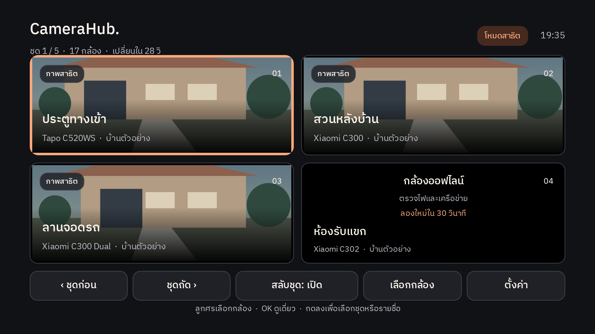

# ผลตรวจ UX/UI CameraHub TV 1.1.0

ปรับแอป Android TV แบบ native ในโครงการนี้ ใช้ Android Views + Kotlin และ Media3 เดิม ไม่เปลี่ยนบริการ Windows ที่กำลังรับภาพ ไม่ไปติดตั้งบนทีวีหรือ NAS จริงในรอบนี้

## สิ่งที่เปลี่ยน

- พื้นชาร์โคล ตัวอักษรงาช้าง สีเลือกส้มอิฐ ฟอนต์ IBM Plex Sans Thai ฝังใน APK รวมไอคอนและ banner ใหม่
- เริ่มจาก 2×2 ภาพ ไม่มีรายชื่อแคบ ๆ บังตลอดเวลา ปุ่ม 48dp และกรอบเลือก 4dp มีขอบปลอดภัยจาก overscan 48dp ซ้าย/ขวา และ 27dp บน/ล่าง
- ลูกศรเลือกภาพ → OK ดูเดี่ยว → Back กลับมาชุดและกล้องเดิม เดินไปเมนูด้านล่างและกลับมาช่องเดิมได้แม้ชุดสุดท้ายเหลือกล้องเดียว
- รายชื่อแบบเปิดเฉพาะเมื่อใช้ แสดงชื่อ 2 บรรทัดตามจำเป็นพร้อมรุ่นแยกบรรทัด จำกัดโฟกัสไว้ในรายชื่อขณะเลือก
- เปลี่ยนชุดก่อน/ถัด และวนชุดละ 4 ทุก 30 วินาที คงกล้องมีปัญหาไว้ในชุดด้วย หยุดนับขณะใช้เมนู ดูเดี่ยว หรือหมุน เก็บค่าพัก/เปิดการวนชุดไว้
- ซ่อนเมนูหลังไม่กดรีโมต 8 วินาทีเพื่อขยายพื้นที่ภาพ และแสดงเมื่อกดปุ่มอีกครั้ง
- อ่านชื่อ/รุ่น/ลำดับจากเครื่องกลางทุก 15 วินาที การเปลี่ยนชื่อหรือสถานะไม่ทำลายตัวเล่นทุกตัว และไม่ย้ายจุดเลือกจากปุ่มเปลี่ยนชุด
- พื้นดำระบุปัญหาและเวลาลองใหม่ มี deadline รับภาพ 20 วินาที, retry 10/20/40/60 วินาทีขณะเปิดแอป ไม่ลองบัญชีที่หมดอายุวนอัตโนมัติ
- แสดงภาพสดเมื่อได้รับเฟรมจริงและตัวเล่นกำลังเล่น ล้างป้ายภาพสดขณะ buffering และปิดภาพค้างด้วยพื้นดำหากยังรอข้อมูล
- หมุนเฉพาะโหมดที่ผู้ใช้เลือกและต้องมีภาพก่อน แยก worker ส่งคำสั่งออกจากการอ่านรายชื่อ จำกัด in-flight หนึ่งรายการ เก็บกล้อง/เครื่องกลาง/สิทธิ์เดิมสำหรับส่งหยุด ไม่มีคิวคำสั่งเคลื่อนที่สะสม ส่ง stop ก่อนเปลี่ยนทิศหรือปลายทาง และ stop retry ได้อีกหนึ่งครั้ง
- จับคู่ 2 ขั้นพร้อม countdown และผลรอ/ปัญหาค้างบนหน้า เปลี่ยนเครื่องกลางแล้วเก็บการเชื่อมเดิมจนกว่าอนุมัติเครื่องใหม่และบันทึกสิทธิ์สำเร็จ

## ผลตรวจ

| รายการ | ผล |
| --- | --- |
| Kotlin / Android release build | ผ่าน |
| Unit tests รวม | **27 ข้อ ผ่านทั้งหมด** |
| Paging เดิม | 2 ข้อ |
| ตรวจ HTTPS address เดิม | 4 ข้อ |
| Viewing state, กล้องหาย/เปลี่ยนชื่อ, หน้าสุดท้าย, idle tour, retry | 7 ข้อ |
| ลำดับ motor request, slow reply, ปล่อยปุ่ม, สลับกล้อง/ทิศ, stop retry, close | 5 ข้อ |
| Android Views + D-pad focus + native graphics (Robolectric, Android API 28) | 7 ข้อ |
| หน้าเชื่อมต่อครั้งแรก: ขอบจอ/HTTPS/แจ้ง URL ผิดโดยไม่เริ่มเชื่อม | 2 ข้อ |
| Android lintRelease | ผ่าน **0 errors / 18 warnings** |
| ลายเซ็น APK | apksigner verify ผ่าน v2, signer 1 ราย |
| การอัปเดตทับ | application ID เดิม, versionCode 1 → 2, certificate SHA-256 ตรงกับ APK เดิม |
| ข้อมูลตัวอย่าง/บัญชี | รูปตัวอย่างสร้างใน test เท่านั้น ไม่ใช้ภาพหรือบัญชีกล้องจริง |
| บริการ Windows เดิมหลัง build | Docker app health: healthy ไม่ได้ restart/redeploy |

Lint warnings ที่เหลือเป็นคำแนะนำเรื่องเวอร์ชัน library ที่ตรึงไว้, landscape สำหรับทีวี, constructor ของ Views ที่สร้างด้วยโค้ด, manifest attributes บน Android รุ่นเก่า, backup rules และ localization ไม่ได้ปิด lint หรือซ่อน error เพื่อให้ build ผ่าน แก้ style ที่ต้อง API 27 ออกเพื่อคงขั้นต่ำ API 26

## ภาพหน้าจอจาก native Android renderer

ภาพเหล่านี้วาดจาก **TvMonitorView ตัวจริง** ในชุดทดสอบ Android 960×540dp แล้วส่งออก 1920×1080 พื้นที่ภาพเป็นภาพบ้านเรขาคณิตจำลองใน ImageView ไม่ใช่ภาพกล้องหรือการทดสอบถอดรหัสวิดีโอของทีวี

- [ซ่อนเมนูเพื่อดู 4 ช่อง](images/tv-1.1.0/02-quiet-four-cameras.png)
- [รายชื่อกล้องพร้อมรุ่น](images/tv-1.1.0/03-camera-picker.png)
- [ภาพเดี่ยวและปุ่มหลัก](images/tv-1.1.0/04-single-camera.png)
- [โหมดหมุนกล้อง](images/tv-1.1.0/05-pan-tilt-mode.png)
- [หน้าเชื่อมต่อครั้งแรก](images/tv-1.1.0/06-first-setup.png)

## ไฟล์ส่งมอบ

- `releases/camerahub-tv-1.1.0.apk` — 3,888,833 bytes / versionName 1.1.0 / versionCode 2 / minSdk 26 / targetSdk 35
- APK SHA-256: `5d03be10f19a144c1fef3c67176dc049f74eb46150653da2dde956a5f923a4eb`
- Certificate SHA-256 (public): `79105043d3bbd4e37e4835fe3362e13e87b2bd5581b1e3ec3f25d4d9f695657b`
- [คู่มือรีโมตและติดตั้ง](TV_GUIDE.th.md)
- Source: `android-tv/app/src/main/java/local/camerahub/tv/` และ resources ในโครงการ

APK ใหม่มี checksum แยกของตัวเอง ZIP/ARM64 และไฟล์ APK 1.0.0 เก่ายังคงเป็นชุดก่อนหน้า ไม่ได้สร้างแพ็กเกจเหล่านั้นใหม่หรืออ้างว่ารวมการแก้ครั้งนี้แล้ว

## ยังไม่ตรวจบนอุปกรณ์จริง

ยังไม่มีการติดตั้ง APK นี้บน Mi TV/Android TV, ใช้รีโมตจริง, ตรวจการถอดรหัส HLS 1/4 ช่อง, ฟังเสียงผ่านลำโพงทีวี, ทดสอบคีย์/มอเตอร์ผ่านทีวี, ตรวจ sleep/wake หรือจับคู่ผ่าน HTTPS/Tailscale ของอุปกรณ์จริง ผล unit/native renderer ไม่แทนผลตรวจเหล่านั้น

ขั้นต่อไปเมื่อติดตั้งทีวีคือเตรียม URL HTTPS ของเครื่องกลาง (127.0.0.1 ของ Windows ใช้บนทีวีไม่ได้) ลง APK แล้วอนุมัติรหัสจากมือถือ เริ่มภาพเดี่ยวก่อนตรวจ 4 ช่องและการวนชุด ดูรายการในคู่มือ

อ้างอิงการออกแบบ: [Android TV layouts / overscan / remote](https://developer.android.com/training/tv/playback/compose/layouts), [Media3 player events](https://developer.android.com/media/media3/exoplayer/listening-to-player-events), [Robolectric 4.14.1](https://github.com/robolectric/robolectric/releases/tag/robolectric-4.14.1)
